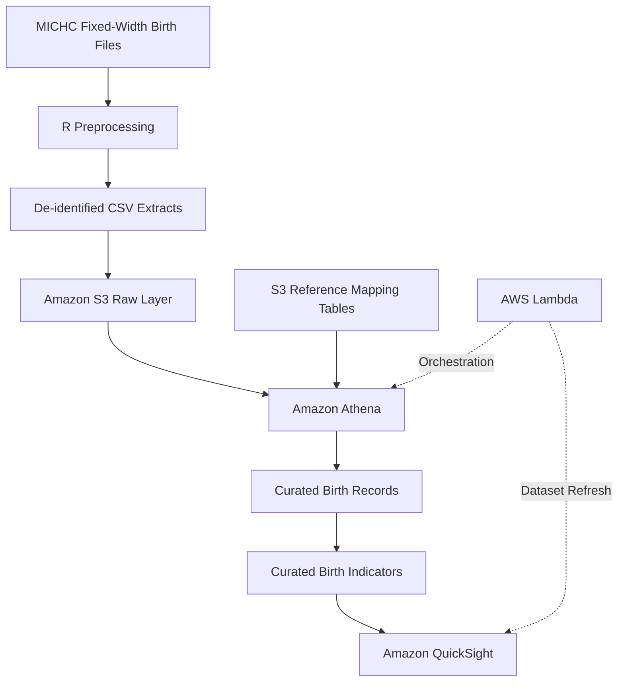

# MICHC Birth Data Pipeline

## Project Overview

The MICHC Birth Data Pipeline is an automated, cloud-based public health data pipeline designed to support maternal and infant health surveillance in Orange County, New York.

The pipeline transforms maternal and infant birth records into standardized, analysis-ready datasets and aggregated public health indicators using Amazon Web Services (AWS).

This project expands upon the existing public health data pipeline architecture developed for community health indicators, communicable diseases, and sexually transmitted infections, extending its capabilities to maternal and infant health surveillance.

## Project Objectives

- Standardize and process maternal and infant birth data.
- Automate data transformation and aggregation.
- Calculate maternal and infant health indicators.
- Support demographic and geographic stratification.
- Enable historical trend analysis and monthly data updates.
- Provide interactive public health visualizations.

## Data Source

Maternal and infant birth records obtained through the MICHC data source.

Historical annual extracts and cumulative monthly extracts are processed to support longitudinal analysis.

The pipeline selects the most recent available extract for each birth year to prevent duplicate counting while preserving historical records.

Individual-level source data are not included in this repository.

## Technologies Used

| Technology | Purpose |
|---|---|
| R | Fixed-width file parsing and initial data preprocessing |
| Amazon S3 | Raw, reference, and curated data storage |
| AWS Glue Data Catalog | Database and table metadata management |
| Amazon Athena | SQL-based data transformation and aggregation |
| AWS Lambda | Automated pipeline execution |
| Python | Pipeline orchestration |
| Boto3 | AWS service integration |
| Amazon QuickSight | Interactive dashboards and visualizations |
| AWS IAM | Access and permissions management |
| GitHub | Version control and project documentation |

## Pipeline Architecture

## Data Architecture

### Raw Layer

Stores preprocessed birth data in CSV format using a partitioned S3 directory structure.

### Reference Layer

Contains standardized reference tables used to translate categorical codes into descriptive labels and define public health indicators.

### Curated Layer

The curated layer consists of two primary datasets:

#### MICHC Birth Records

- Selects the latest available extract for each birth year.
- Identifies eligible Orange County resident births.
- Standardizes source variables.
- Applies categorical reference mappings.
- Calculates derived maternal and infant health variables.
- Stores processed records in Apache Parquet format.

#### MICHC Birth Indicators

- Aggregates standardized birth records.
- Produces 31 maternal and infant health indicators.
- Calculates numerators, denominators, percentages, and unknown counts.
- Supports eight demographic stratification dimensions.
- Provides countywide and locality-level results.
- Stores aggregated indicators in Apache Parquet format.

## Public Health Indicator Categories

The pipeline supports analysis across multiple maternal and infant health domains, including:

- Birth statistics
- Maternal demographics
- Maternal risk factors
- Prenatal care
- Labor and delivery
- Infant characteristics and health outcomes
- Infant preventive care and feeding
- Insurance and assistance

## Pipeline Automation

An AWS Lambda function orchestrates the data refresh process:

1. Repair raw Athena table partitions.
2. Remove existing curated birth records.
3. Rebuild the curated birth records table.
4. Remove existing curated birth indicators.
5. Rebuild the curated birth indicators table.
6. Initiate an Amazon QuickSight dataset refresh.

The automated workflow ensures that newly uploaded extracts can be incorporated into the analytical environment without manually executing each SQL transformation.

## Monthly Data Refresh Workflow

1. Receive the latest MICHC birth data extract.
2. Process the fixed-width source file using R.
3. Remove unnecessary identifiable information.
4. Export the preprocessed dataset to CSV.
5. Upload the dataset to the appropriate Amazon S3 partition.
6. Execute the AWS Lambda refresh function.
7. Verify Athena query execution and curated datasets.
8. Confirm the QuickSight dataset refresh and validate dashboard results.

## Data Visualization

Amazon QuickSight provides interactive visualizations supporting:

- Historical trends
- Maternal and infant health indicators
- Demographic comparisons
- Countywide and locality-level analysis
- Birth counts and percentage-based measures
- Interactive filtering and tabular reporting

## Data Quality and Validation

Validation procedures include:

- Birth counts by year
- Latest extract verification
- Reference mapping validation
- Geographic aggregation consistency
- Numerator and denominator verification
- Unknown and missing value assessment
- Dashboard consistency following automated refreshes

## Data Privacy and Security

This repository is intended to document the technical architecture, transformation logic, and automation processes associated with the MICHC Birth Data Pipeline.

Individual-level birth records, personally identifiable information, confidential source files, credentials, and sensitive infrastructure configuration are excluded from this repository.

## Future Enhancements

- Automated scheduling of monthly pipeline refreshes
- Expanded data quality monitoring
- Enhanced pipeline logging and error notifications
- Additional maternal and infant health indicators
- Expanded geographic and demographic analytical capabilities

## Project Status

**Operational**

The data transformation pipeline, curated datasets, interactive dashboard, and AWS Lambda refresh workflow have been successfully implemented and tested.
